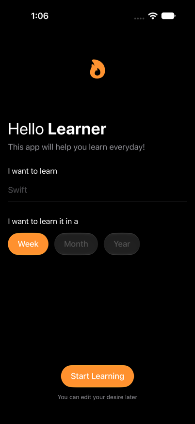
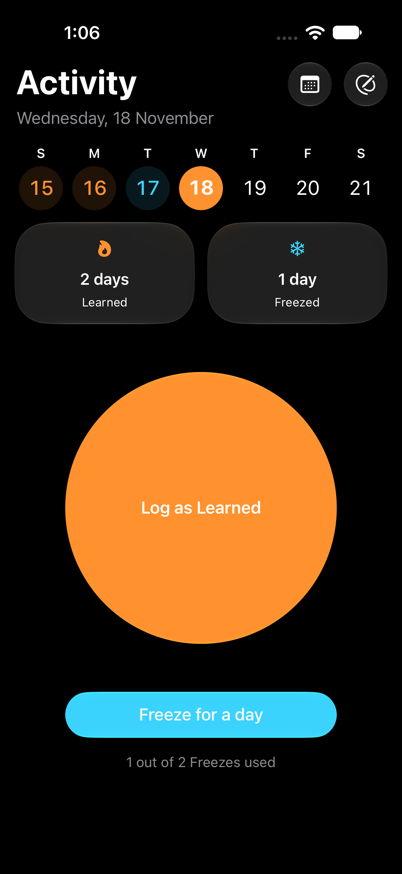
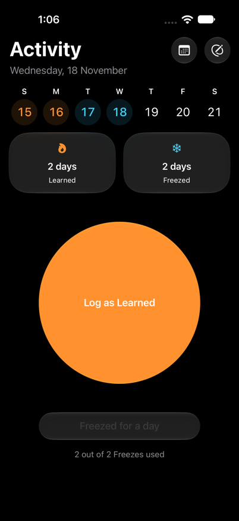
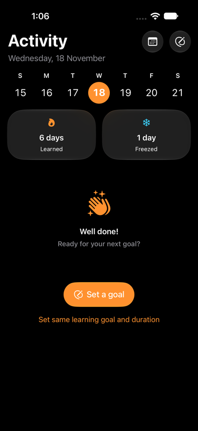

# 🔥 Learning Journey

**Learning Journey** helps you build a daily learning habit. Pick what you want to learn and for how long (a week, a month or a year), then log every day as *learned* or *freezed* to keep your streak alive.

---

## ✨ Main features

- **Set a learning goal**: type what you want to learn (for example "Swift") and choose a **Week**, **Month** or **Year**. Onboarding shows only the first time you open the app.
- **Log your day**: tap **Log as Learned**, or **Freeze for a day** when you need a break without losing your streak.
- **Fix a wrong tap**: already logged today? Tap the other button to switch between *Learned* and *Freezed*.
- **Streak counters**: see how many days you **learned** and **freezed** in your current streak.
- **Freezes per goal**: 2 for a week, 8 for a month, 96 for a year, with a live "1 out of 2 Freezes used" counter.
- **32-hour rule**: if you don't log anything for more than 32 hours, the streak starts over.
- **This week at a glance**: the days of the week are colored orange (learned) or blue (freezed).
- **Change your goal any time**: the app asks you to confirm first, because changing the goal restarts your streak.
- **Goal finished**: when the period ends you'll see **"Well done!"** or **"You didn't reach your goal this time."**, then set a new goal or repeat the same one.
- **Activities calendar**: every month since you installed the app, with each day colored by how it was logged.
- **Day details**: tap a day in the calendar to see the goal's name, its length (week, month or year) and the dates it ran.
- **Light and dark mode**: follows your iPhone's appearance setting automatically.
- **Liquid Glass design**: buttons, cards and the app icon use iOS's Liquid Glass look.
- **Saved on your phone**: your goal and days are kept even after you close the app.

---

## 📱 Screenshots

| Onboarding | Activity | Freezed today | Goal completed |
|:---:|:---:|:---:|:---:|
|  |  |  |  |

---

## 🛠 Technologies used

| | |
|---|---|
| **Language** | Swift |
| **UI** | SwiftUI |
| **Design** | Liquid Glass (`glassEffect`, `GlassEffectContainer`), SF Symbols |
| **Architecture** | MVVM (Model, ViewModel, View) |
| **State** | Observation framework (`@Observable`, `@State`, `@Binding`) |
| **Saving data** | `UserDefaults` + `Codable` (JSON) |
| **Dates** | Foundation `Calendar` and `Date` |
| **App icon** | Icon Composer (light, dark, clear and tinted) |
| **Design file** | Sketch |
| **Tools** | Xcode 27, iOS 27 Simulator |

---

## ▶️ How to run

1. Open `com.yaraalkhalafpersonalteam.LearningJourney.xcodeproj` in **Xcode 27** or later.
2. Pick an iPhone simulator (or your iPhone) running **iOS 27**.
3. Press **⌘ R**.

**Optional launch arguments** (Debug builds only). Add them in Xcode under **Product → Scheme → Edit Scheme → Run → Arguments**:

| Argument | What it does |
|---|---|
| `-resetData` | Deletes saved data, so the app starts from onboarding like a fresh install. |
| `-mockHistory` | Fills the previous months with demo days and goals, to show off the calendar. |

---

## 📏 App rules

| Rule | Details |
|---|---|
| Freezes | 2 per week goal · 8 per month goal · 96 per year goal |
| One log per day | Today is either *learned* or *freezed*; tap the other button to switch. |
| Buttons | The chosen button turns grey. Freeze is disabled when no freezes are left. Both reset at 12 AM. |
| Streak ends | More than **32 hours** without logging (learned or freezed). |
| Streak resets | Also when you change your learning goal. |
| Goal completed | Every day of the period was logged. Otherwise the goal is "not met". |
| History starts | On the day the app was installed. |
| Wording | "1 day" vs "2 days" (singular when the number is 1). |

---

## 🗂 Project structure (MVVM)

```
Untitled Project/
├── App/            LearningJourneyApp, RootView: app entry point, onboarding or activity
├── Models/         GoalPeriod, LearningGoal, DayLog, CalendarDay, ProgressCalculator (the rules)
├── Services/       LearningStore (app data), LearningPersistence (saving)
├── ViewModels/     One per screen: Root, Onboarding, Activity, GoalEditor, Calendar
├── Views/
│   ├── Onboarding/ First screen
│   ├── Activity/   Main screen: week, counters, log buttons, goal finished
│   ├── Goal/       Learning goal form and editor
│   ├── Calendar/   Months, day grid, day details popover
│   └── Components/ DayCircle
├── DesignSystem/   Theme (sizes), glass buttons
├── MockData/       Demo history for previews and -mockHistory
├── Assets.xcassets Colors with light and dark versions
└── AppIcon.icon    Icon Composer app icon
```

- **Model**: the data and the rules. `ProgressCalculator` decides the streak, freezes and whether a goal is completed.
- **ViewModel**: gets the data ready for one screen and handles its buttons.
- **View**: only draws what its ViewModel gives it.

---

## 👩‍💻 Author

Made by **Yara Alkhalaf**.
